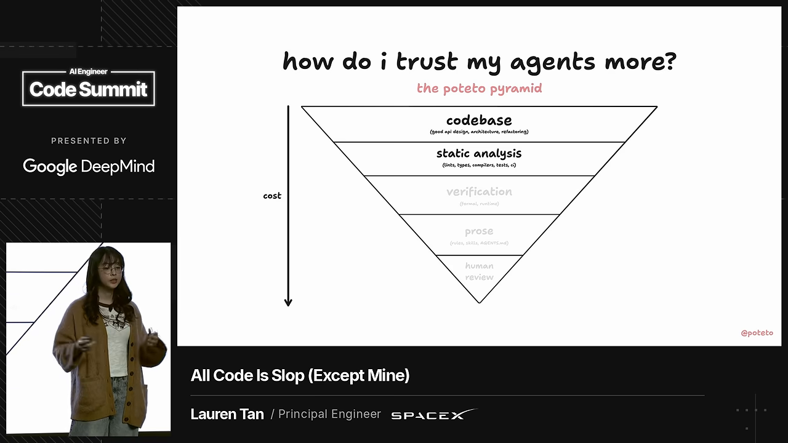
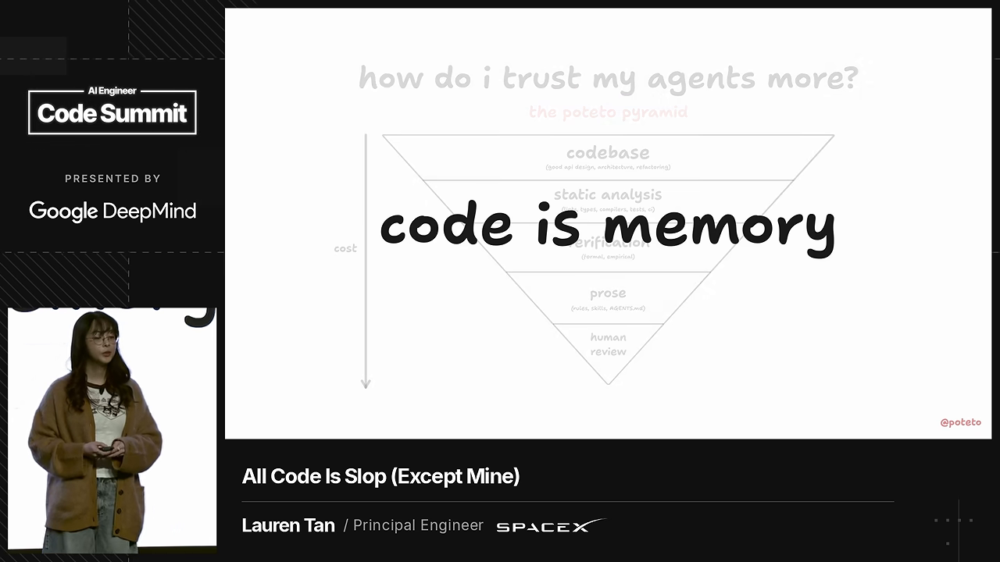
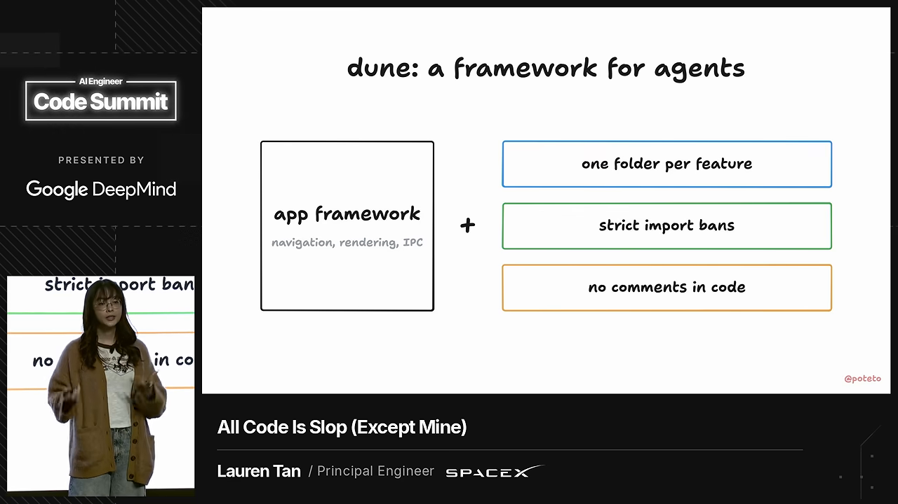
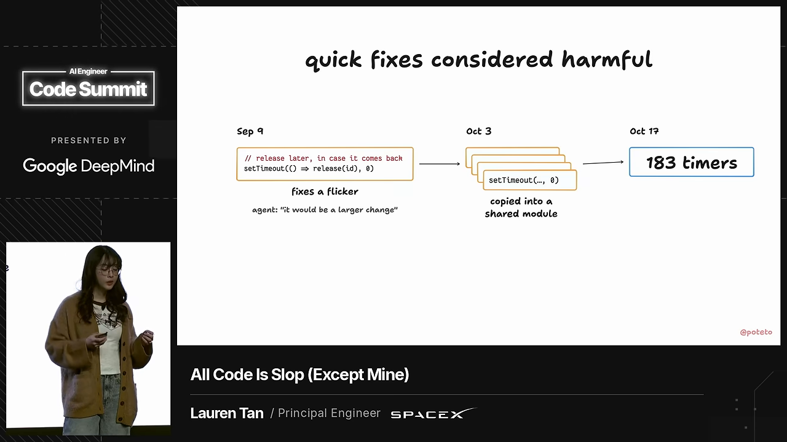

# All Code Is Slop (Except Mine)

- **Speaker**: Lauren Tan (Potato / @sugarpirate_, 前 Cursor 工程師、現任 xAI Grok Bot 團隊核心成員)
- **Conference / Channel**: AI Engineer Code Summit (Presented by Google DeepMind)
- **Video Link**: [YouTube: All Code Is Slop (Except Mine)](https://youtu.be/O_zcc6Xl12g)
- **Duration**: 17 分 31 秒
- **Keywords / Tags**: #AIAgents #CodeSlop #SoftwareArchitecture #LintRules #FormalVerification #DeterministicGuardrails #Cursor #GrokBot #Dune

---

## Executive Summary (TL;DR)
在前 Cursor 核心工程師、現任 xAI Grok Bot 團隊的 Lauren Tan 看來，當軟體工程全面引入自主 AI Agents 時，開發範式已從傳統「人工敲代碼」演進為「軟體工廠（Software Factory）」。Lauren 揭露了團隊單月由 Agent 交付高達 **11,000 個 Pull Requests (PR)**、且代碼回滾率（Revert Rate）僅 **~0.5%** 的驚人工程成果。其核心秘訣在於建構**「高信任度的確定性約束環境」**：透過原創的「Poteto 倒金字塔模型（5 層）」，將時間精力集中於頂層的代碼庫架構、靜態分析與形式化驗證，廢止容易引發垃圾代碼（Slop）的語法與逃避性註解，最終將底端的人工審查（Human Review）壓縮至趨近於零。

---

## I. 核心論點與背景動機 (Core Thesis & Motivation)

### 1. 現狀衝擊：從手動編程到「代碼洪流」
- **過去的工程步調**：在 2024 年以前，工程師一天審查 3 個同事寫的 PR 就算是正常工作量。
- **現在的 Agent 時代**：單一工程師身後運作著數百甚至數千個 AI Agents，每天產生的 PR 數量暴增至 300 到 3,000 個，代碼如同有機體（Organic Stream）般持續湧入。
- **核心挑戰**：AI Agents 產生程式碼的成本趨近於零，如果缺乏約束，這些代碼就會淪為毫無品質的「垃圾代碼（Code Slop）」。
- **工程師的新使命 (The New Meta)**：
  > 現代軟體工程師的核心職責，不再是親手寫代碼，而是**「在代碼生產力呈指數級爆發的同時，維持甚至大幅提升代碼庫的整體品質」**。

### 2. 花園隱喻 (The Garden Analogy)
Lauren 提出了一個深刻的隱喻：**Codebase 就像一座花園**。
- AI Agents 生成代碼時，最大的輸入依據就是現有的 Codebase。
- 如果你的花園裡長了雜草（未被清理的反模式、臨時應急的 Workaround、廢棄的過時寫法），Agent 在尋找參考範式時就會自動模仿並複製這些雜草。
- 在數千個 Agent 的並行擴散下，雜草幾天內就會淹沒整個系統。因此，軟體工程師的工作本質正轉變為**「花園的園丁（Gardening）」**——維持土壤純淨，架設剛性的混凝土支架（Constraints），讓新代碼依循正確的骨架生長。

---

## II. Figure & Table Deep Dive (關鍵圖表四步深度解析)

### Figure 1: The Poteto Pyramid（環境投資倒金字塔）



<div class="figure-caption">
<strong>Figure 1. The Poteto Pyramid (How do I trust my agents more?).</strong> 演講原版倒金字塔架構，由頂部面積最大、成本與心力投入最多的 Codebase，一路遞減至最底部尖端的人工審查 (Human Review)。左側箭頭標明成本/時間投入方向。
</div>

1. **視覺組件拆解**：
   - 幾何輪廓：呈現完整的倒三角形（$\nabla$），左側附有由上而下的垂直箭頭標記 `cost`。
   - 頂部第一層（最寬）：`codebase (good api design, architecture, refactoring)`。
   - 第二層：`static analysis (lints, types, compilers, tests, ci)`。
   - 第三層：`verification (formal, runtime)`。
   - 第四層：`prose (rules, skills, AGENTS.md)`。
   - 最底部尖端（最窄）：`human review`。
2. **資料與機制流向**：
   - 越往金字塔上方，規則的機械化與確定性程度越高，工程師應投入 80% 以上的時間進行架構重構與靜態分析防護。
   - 透過前三層的自動化過濾，讓不可行的代碼在編譯期直接夭折；只有極少數高階決策才交由第四層自然語言提示詞；最終交付時，人工審查的負擔被極度壓縮至尖端，甚至達成無人化自動合併。
3. **物理意義與設計意圖**：
   - 打破「只要給 LLM 寫更多 Prompt 就能防錯」的迷思。自然語言（Prose）充滿隨機性與歧義，純 Prompt 約束是脆弱的軟約束；真正的信任必須建立在編譯器、型別系統與架構邊界的剛性約束之上。
4. **關鍵量化結論**：
   - 面積比例：頂層 `codebase` 與 `static analysis` 佔據整體模型 70% 以上面積。
   - 人工審查目標：將 `human review` 壓縮到極致尖點（趨近於 0% 人工逐行審查）。

---

### Figure 2: Code is Memory（代碼即記憶與花園本質）



<div class="figure-caption">
<strong>Figure 2. Code is memory.</strong> 演講核心警示：Codebase 不僅是程式執行的本體，更是所有自主 Agent 最大的輸入 Context 與長期記憶來源。
</div>

1. **視覺組件拆解**：
   - 背景為淡化的 Poteto 倒金字塔架構，中央以巨大的粗體字直接點出核心命題：`code is memory`。
2. **資料與機制流向**：
   - Agent 每次被指派新任務時，必先檢索既有專案結構與歷史代碼。
   - 若 Codebase 中充斥著髒代碼，Agent 的上下文視窗（Context Window）就會被髒代碼填滿，並將其視為專案的慣用風格（Established Pattern）進行病毒式複製。
3. **物理意義與設計意圖**：
   - 解釋為何「修復一個 Bug 不能只在對話框裡叮嚀」，而必須徹底清理代碼庫土壤。只要代碼庫保留不良寫法，後續成千上萬的 Agent 就會將其作為「記憶」永遠繼承下去。
4. **關鍵量化結論**：
   - 確立原則：Codebase 是驅動 Agent 生成品質的決定性輸入權重（Weight > 90%）。

---

### Figure 3: Dune: A Framework for Agents（專為 Agent 打造的客戶端架構）



<div class="figure-caption">
<strong>Figure 3. Dune: a framework for agents.</strong> xAI Grok Bot 團隊為 Agent 打造的內部客戶端框架，由三大剛性支柱構成：單功能單資料夾、嚴格禁止跨層引入、代碼庫徹底零註解。
</div>

1. **視覺組件拆解**：
   - 左側核心模組：`app framework (navigation, rendering, IPC)`。
   - 右側三大架構約定（三個色彩方框）：
     - 藍框：`one folder per feature`（按功能劃分獨立資料夾，物理隔離邊界）。
     - 綠框：`strict import bans`（透過 Linter 嚴禁跨執行緒與跨模組非法引用）。
     - 橘框：`no comments in code`（在產品代碼中徹底禁用註解）。
2. **資料與機制流向**：
   - 透過實體目錄劃分（例如 `electron-main` 與 `electron-renderer`），讓 Agent 的檔案檢索路徑完全受限於目錄結構；依賴關係圖分析器（Dependency Graph Analyzer）自動掃描 AST，一旦發現跨層引用立即拋出編譯中斷錯誤。
3. **物理意義與設計意圖**：
   - 證明優秀的架構可以「在物理上直接根除錯誤產生的可能（Categorical Elimination）」。不再依賴工程師在 Review 時用肉眼辨識架構違規。
4. **關鍵量化結論**：
   - 零容忍指標：完全禁絕 Electron 渲染執行緒引入後端代碼，介面卡頓（Jank）率降為零。

---

### Figure 4: Quick Fixes Considered Harmful（臨時補丁的指數級繁衍）



<div class="figure-caption">
<strong>Figure 4. Quick fixes considered harmful (183 Timers Incident).</strong> 實戰踩坑時間軸：從 9 月 9 日 Agent 寫下一行帶有合理化註解的 setTimeout 臨時修復，僅歷時 5 週便在專案中繁衍成 183 個命令式定時器！
</div>

1. **視覺組件拆解**：
   - 水平時序推進圖，包含三個關鍵時間節點：
     - **Sep 9**：Agent 寫下 `// release later, in case it comes back` 並調用 `setTimeout(() => release(id), 0)` 解決畫面閃爍（Flicker），Agent 辯解「如果要徹底改動會牽涉太大」。
     - **Oct 3**：該臨時寫法被另一個 Agent 複製進共享模組（Shared Module）。
     - **Oct 17**：專案中赫然爆發出 **183 個獨立的 Timers**！
2. **資料與機制流向**：
   - 第一個 Agent 為了走捷徑，使用命令式定時器解決宣告式狀態衝突，並用文字註解自我合理化 $\to$ 後續 Agent 視其為標準寫法進行廣泛重用 $\to$ 大量定時器被快速建立與銷毀，觸發 JavaScript 嚴重的垃圾回收停頓（Major Garbage Collection Pause），導致應用程式效能全面崩潰。
3. **物理意義與設計意圖**：
   - **這是為什麼團隊決定「禁用 99% 註解」的最強鐵證！**
   - 註解非但無法保證代碼品質，反而成為 Agent 用來偷懶、逃避根本修復的「逃生門（Escape Hatch）」。
4. **關鍵量化結論**：
   - 擴散速度：單一應急寫法在 38 天內擴散為 **183 倍**。
   - 團隊處方：全面禁用定時器與無用註解，將檢查直接改寫為報錯型 Linter，迫使 Agent 必須重構根源邏輯。

---

## III. 核心架構與分層拆解 (Architecture Deep Dive)

綜合上述四張核心圖表，Lauren 提出的軟體工廠防護體系如下：

```
╲                                                                     ╱
 ╲  1. Codebase (頂部最寬/耗資最大): Good API design, architecture   ╱
  ╲─────────────────────────────────────────────────────────────────╱
   ╲  2. Static Analysis: Lints, types, compilers, tests, CI       ╱
    ╲─────────────────────────────────────────────────────────────╱
     ╲  3. Verification: Formal verification, runtime invariants ╱
      ╲─────────────────────────────────────────────────────────╱
       ╲  4. Prose: Rules, skills, AGENTS.md (脆弱/需主觀判斷)  ╱
        ╲─────────────────────────────────────────────────────╱
         ╲  5. Human Review (底部尖端/最少): 追求趨近於零    ╱
          ╲                                                 ╱
           ▼
```

1. **Layer 1: 代碼庫本體 (Codebase Architecture)**  
   - 投入 80% 心力。追求「不可被誤用的 API 設計」。當語法太複雜（如 React `useEffect`），直接在產品層全面 Ban 掉，只留底層封裝。
2. **Layer 2: 確定性防護欄 (Deterministic Guardrails)**  
   - 靜態型別、Linter、AST 檢查、單元測試。保證 100% 可重現性，任何人都無法妥協。
3. **Layer 3: 驗證體系 (Formal & Runtime Verification)**  
   - 透過 TLA+ 窮舉分散式狀態機，透過 Lean 進行數學級定理證明，驗證核心不變量（Invariants）。
4. **Layer 4: 自然語言提示詞 (Prose: Prompts & AGENTS.md)**  
   - 保持極簡。絕不將可被程式化檢查的規則寫進 Prompt。
5. **Layer 5: 人工審查 (Human Review)**  
   - 目標是壓縮到尖端零審查。當前置防護足夠牢固，讓 Agent 自行合併 90% 以上的 PR。

---

## IV. 關鍵量化指標與法則 (Quantitative Findings & Golden Rules)

1. **極致交付數據**：
   - 單月交付成果：高達 **11,000 個 Pull Requests**。
   - 代碼回滾率（Revert Rate）：維持在極度嚴苛的 **~0.5%** 水準。
2. **工程師的黃金反饋迴圈 (The Golden Rule)**：
   > **「每一次當你需要手動糾正 Agent 的錯誤時，絕對不要只把錯誤寫進對話框；必須將其轉化為一條確定性的 Lint 規則、型別限制，或徹底重構 API 設計！」**

---

## V. 概念互聯 (Cross-Referenced Concepts)
- [[deterministic-guardrails|確定性防護欄與編譯約束 (Deterministic Guardrails)]]
- [[ai-agents-code-generation|AI Agents 規模化代碼生成體系 (Scaling AI Coding Agents)]]
- [[formal-verification-llm|形式化驗證在 AI 工程的應用 (Formal & Runtime Verification)]]
