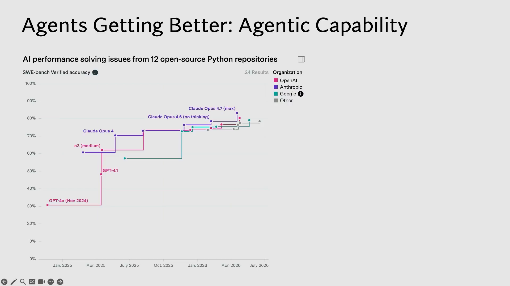
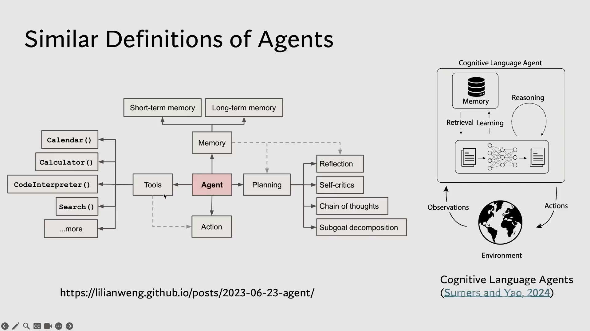
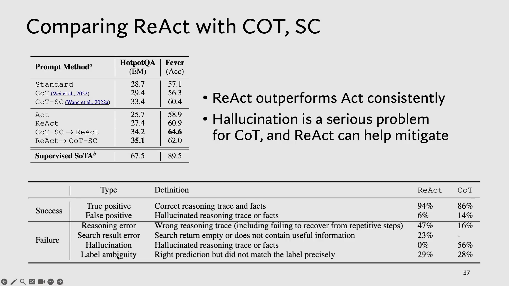
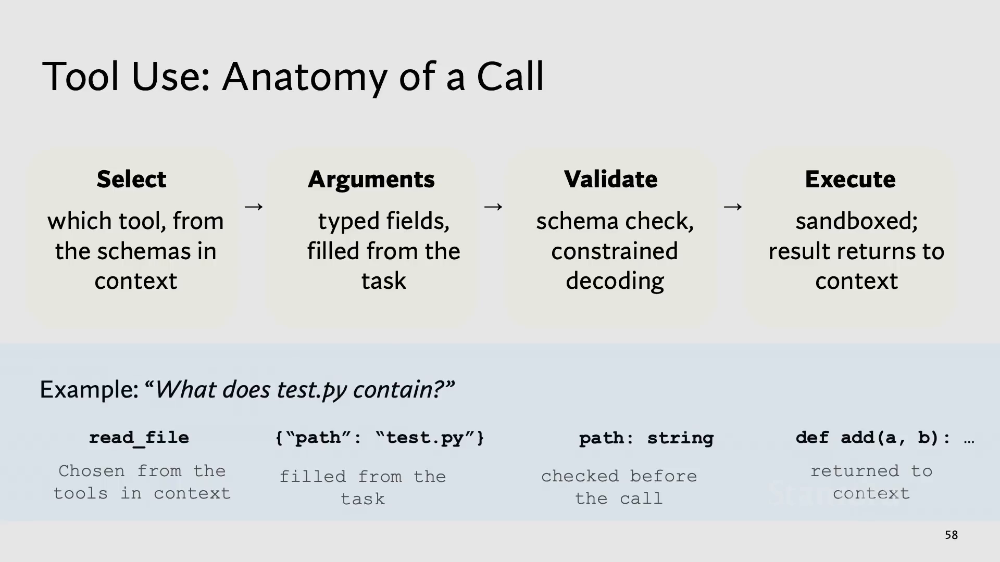
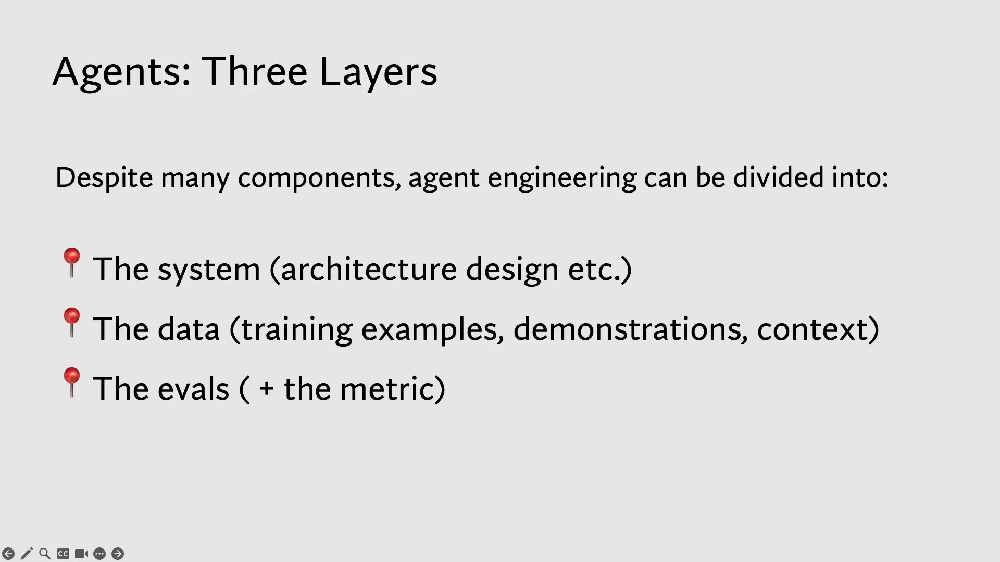

# What Are AI Agents? Agentic Systems Explained | Stanford CS329Z Lecture 1 with Diyi Yang

- **Speaker**: Prof. Diyi Yang（楊笛一，史丹佛大學計算機科學系助理教授、SALT 實驗室主持人）
- **Co-Instructors**: Michael Ryan（史丹佛二年級博士生、DSPy 核心貢獻者）、John Yang（史丹佛博士生、SWE-bench 與 SWE-agent 創始人）
- **Host / Course**: Stanford University CS329Z: Engineering AI Agents (Lecture 1)
- **Video URL**: [https://youtu.be/DGI4vucR71w](https://youtu.be/DGI4vucR71w)
- **Duration**: 01:09:35（70 分鐘完整學術公開課）
- **Keywords / Tags**: #StanfordCS329Z #AIAgents #AgenticSystems #ReAct #ToolUse #MemorySystems #SWEbench #CognitiveArchitecture
- **Interactive Presentation**: [開啟第四講獨立全螢幕教學簡報 (Reveal.js)](file:///C:/Users/USER/Desktop/AI_Video_Wiki/slides_04_stanford_cs329z.html?v=clean_20261124) | [頁內預覽頁面](../presentation_04.md)

---

## Executive Summary (TL;DR)
本課程為史丹佛大學正式開設的代理系統工程課《CS329Z: Engineering AI Agents》第一講，由知名 NLP 與代理系統學者 Diyi Yang 教授主講，並由 SWE-bench 創始人 John Yang 與 DSPy 貢獻者 Michael Ryan 共同助教。講座從人工智慧傳統的 Russell & Norvig 代理定義出發，精闢剖析當代「基底大語言模型（LLM）」與「自主代理系統（Agentic System）」的本質分野。核心論述指出：單純擴展模型參數的靜態單輪推論已面臨瓶頸，唯有透過「認知架構（Cognitive Architecture）」——結合動態推理與規劃（Reasoning & Planning）、階層記憶系統（Short-term & Episodic/Semantic Memory）以及嚴密的四步工具調用管線（Tool Selection, Argument Extraction, Schema Validation, Sandbox Execution），才能將原本高達 56% 幻覺率的單輪 CoT 壓制至 0%，並實現複雜真實世界任務的可靠落地。

---

## I. 全景時間軸深度拆解 (Chronological Breakdown)

### 1. [00:00 - 07:35] 課程設立動機與教學陣容 (Course Motivation & Logistics)
- **跨學科工程定位**：CS329Z 旨在填補「基礎模型預訓練」與「真實世界代理工程」之間的巨大鴻溝。修課學生將深入代理架構底層，不僅使用現成 API，更要親手構建與評估具備自主性的代理系統。
- **頂級師資背景**：主講人 Diyi Yang 為史丹佛大學助理教授，長期致力於人機交互、對話系統與社會化智能代理；共同授課講師 Michael Ryan 為知名宣告式提示詞框架 DSPy 的核心開發者；John Yang 則是當今全球大模型軟體工程基準 SWE-bench、SWE-agent 及 SWE-smith 的發明者。
- **AI 輔助學習原則**：課堂探討學生使用 AI 輔助編程時的認知陷阱——雖然 AI 能大幅增加代碼產出速度，但在課堂概念測驗中，過度依賴 AI 產生代碼的學生對底層原理的理解顯著下降。因此，本課程強調「使用 AI 來學習如何學習（Using AI to learn how to learn）」，而非無腦複製輸出。

### 2. [07:35 - 13:50] 代理的經典定義與現代範式轉移 (Definition of Agents: Russell & Norvig vs. LLM)
- **經典代理哲學**：回溯 Stuart Russell 與 Peter Norvig 在經典教材《Artificial Intelligence: A Modern Approach》中的經典定義：代理是「任何能夠透過感測器（Sensors）感知環境，並透過致動器（Actuators）對環境採取行動的實體」。
- **單輪 LLM vs. 自主 Agent**：
  - **LLM（靜態轉換器）**：接受 Prompt 輸入，單向自回歸輸出 Token，推論結束即終止，對外部世界狀態無持續感知與狀態維護能力。
  - **Agent（動態控制迴圈）**：具備自主循環（Perception $\to$ Cognition/Planning $\to$ Action $\to$ Environment Feedback $\to$ New Perception），能夠根據環境即時回饋自主修正下一步策略。

### 3. [13:50 - 20:40] 代理演進史：從符號邏輯、強化學習到語言代理 (History of Agents)
- **第一階段：符號主義與專家系統 (Symbolic AI & Expert Systems)**：依賴人類專家手工書寫的規則（If-Else 引擎），具備高度可解釋性但無法泛化，面對開放世界時產生「組合爆炸（Combinatorial Explosion）」。
- **第二階段：強化學習代理 (Reinforcement Learning Agents)**：基於馬可夫決策過程（MDP），如 AlphaGo、DQN 與各類 Atari/星海爭霸系統。擅長封閉遊戲環境，但在開放域缺乏常識推理、語言理解與樣本效率極低。
- **第三階段：語言代理的興起 (Language Agents)**：2022 年成為關鍵轉折點。MRKL（Modular Reasoning, Knowledge and Language）提出將外部符號工具與神經模型解耦；隨後 Yao 等人提出 ReAct（Reasoning + Acting），正式開啟現代 LLM 代理時代。

### 4. [20:40 - 27:00] 基底模型 vs. 代理系統：性能與成本之辯 (Foundation Model vs. Agentic System)
- **SWE-bench Verified 演進趨勢**：展示從 GPT-4o、Claude 3.5 Sonnet 到 o3 系列在軟體工程基準上的非線性躍升。單純提升基底模型權重帶來的邊際效益逐漸趨緩，而「代理工作流 + 測試時計算（Agentic Workflow & Test-time Compute）」貢獻了超過 40% 的能力突破。
- **現場學生交鋒：API 成本暴增之謎**：現場學生針對 Terminal-Bench 提問：為何新世代高分代理的 API 調用成本高出數倍至數十倍？Diyi Yang 解釋：高表現源自於代理在後台執行多路取樣、自我反思迴圈與反覆工具探測（Test-time Compute），以計算資源換取確定性突破。

### 5. [27:00 - 33:15] 現代代理三大核心架構 (The Agent Triad & Cognitive Architecture)
- **大腦 (The Brain - Planning & Reasoning)**：負責目標分解、邏輯演譯、動態重規劃與自我反思。
- **感知 (Perception)**：多模態輸入整合、上下文狀態解析、環境觀察（Observation）轉化。
- **行動 (Action & Actuators)**：透過呼叫外部 API、執行 Bash 腳本、瀏覽網頁 DOM 節點來改變外部世界狀態。
- **認知架構對齊**：對比 Lilian Weng（2023）提出的代理架構圖與 Sumers & Yao（2024）的 Cognitive Language Agent，確認現代代理本質上就是由記憶體、推理引擎與工具集合構成的微型作業系統。

### 6. [33:15 - 40:20] 推理與規劃深度對比：ReAct vs. Chain-of-Thought
- **CoT 的致命盲點**：Chain-of-Thought 僅在封閉的權重內部進行自由聯想，缺乏外部事實校驗（Grounding），在多跳問答中極易產生嚴重的「事實幻覺（Hallucination）」。
- **ReAct 的核心機制**：將推理與行動交織（Interleaving Thought and Action）。格式為：`Thought` $\to$ `Action` $\to$ `Observation` $\to$ `Thought`。每一次思考都建立在上一輪環境實際返回的觀察之上。
- **實證故障模式分解**：引用 HotpotQA 與 Fever 實測數據，揭示 ReAct 如何將 CoT 高達 56% 的幻覺率降至 0%，但同時暴露了新的工程挑戰（如 47% 的推理軌跡漂移與 23% 的搜尋空值錯誤）。

### 7. [40:20 - 47:30] 記憶架構全景：短期、情境與語意記憶 (Memory Systems)
- **工作記憶 (Working Memory)**：受限於上下文視窗（Context Window），存放當前會話與即時變數，成本高昂且長程易丟失。
- **長期記憶雙軌模型 (Long-Term Memory Dual-Track)**：
  - **情境記憶 (Episodic Memory)**：記錄代理過往執行的任務軌跡、成功/失敗歷史與使用者個性化互動經歷（如 Park 等人的 Stanford Generative Agents 25人小鎮）。
  - **語意記憶 (Semantic Memory)**：外部化世界知識、領域手冊、靜態規則向量資料庫（RAG）。
- **記憶操作生命週期**：寫入（Ingestion）、壓縮總結（Summarization/Compression）、檢索召回（Retrieval）、遺忘與修剪（Forgetting/Pruning）。

### 8. [47:30 - 53:40] 工具調用演進史：從 Toolformer 到 Schema 規範化 (Tool Use Evolution)
- **早期隱式工具調用**：Toolformer（Schick et al., 2023）透過自監督學習在文字中插入特殊標籤 `<API>...</API>`，讓模型自行決定調用時機與參數。
- **大規模 API 檢索與調用**：UC Berkeley 的 GORILLA 專案，讓模型能夠檢索並準確調用數千個 HuggingFace 與雲端 REST API。
- **現代函數調用 (Function Calling)**：全面轉向 JSON Schema 規範化，將外部工具轉化為強型別介面。

### 9. [53:40 - 58:50] 代理工程三層架構體系 (Agents: The Three Layers)
Diyi Yang 提出代理除錯與設計的終極分類法：
- **系統層 (The System Layer)**：包含認知架構設計、狀態機迴圈、Prompt 模板、記憶管理與執行沙盒。
- **資料層 (The Data Layer)**：用於提示詞的示範案例（In-context Demonstrations）、工具文件描述、高品質訓練資料。
- **評估層 (The Evals Layer)**：真實基準測試（SWE-bench, WebArena）、量化指標設計與錯誤軌跡診斷。

### 10. [58:50 - 64:00] 工具調用解剖學四步管線 (Anatomy of a Tool Call)
詳解每一次可靠工具呼叫的底層四步驟：
1. **選擇 (Select)**：根據上下文與任務意圖，從大量工具 Schema 中檢索出最合適的目標工具（如 `read_file`）。
2. **參數填充 (Arguments)**：提取並填入具備強型別結構的參數（如 `{"path": "test.py"}`）。
3. **驗證關卡 (Validate)**：在實際呼叫前，透過 Schema 檢查器與約束解碼（Constrained Decoding）確保型別無誤，阻斷格式錯誤。
4. **沙盒執行 (Execute)**：在完全隔離的容器或沙盒中執行命令，捕捉標準輸出並將結果（Observation）注入回上下文。

### 11. [64:00 - 69:10] 開放性挑戰與真實事故案例：Operator 買牛奶危機 (Open Problems & Safety)
- **錯誤級聯效應 (Error Cascades)**：在多步驟長鏈條任務中，若單步成功率為 $95\%$，經過 20 步後整體成功率驟降至 $(0.95)^{20} \approx 35.8\%$！代理極易在微小偏差中陷入不可逆的軌跡漂移。
- **Operator 買牛奶實戰災難**：OpenAI 於 2025 年 1 月發布的電腦操作代理 Operator 實測案例。使用者指令為「幫我買生活用品/牛奶」，使用者預期代理會詢問住址與偏好超市；然而 Operator 未經任何意圖校準或確認，直接打開 Instacart，在愛荷華州（Iowa）的一家隨機超市下單搜尋牛奶！
- **真實世界危險性**：代理掌握真實的信用卡、檔案系統與網路權限，一旦缺乏確定性防護欄與確認機制（Human-in-the-loop / Confirmation Gates），將對實體世界造成直接經濟與安全損失。

### 12. [69:10 - 70:00] 總結與課堂展望 (Conclusion)
- 代理系統已從炫技式的單純提示工程，升維成精密且嚴謹的軟體架構工程。未來數講將陸續深入多代理協同（Multi-agent systems）、代碼生成代理（SWE-agent）與即時環境反思機制。

---

## II. 關鍵圖表逐一深度四步解析 (Figure Deep Dive)

### Figure 1: 軟體工程代理能力躍升 (SWE-bench Verified 2024–2025)

1. **視覺組件拆解**：
   - 橫軸為時間線（從 2024 年底跨入 2026 年初）；縱軸為 SWE-bench Verified 基準測試之問題解決精確度（0% 至 100%）。
   - 色彩編碼代表不同頂級 AI 機構：粉紅色代表 OpenAI（GPT-4o, GPT-4.1, o3-medium）、紫色代表 Anthropic（Claude Opus 系列）、藍綠色代表 Google。
2. **資料與機制流向**：
   - 2024 年 11 月，GPT-4o 僅能解決約 30% 的實際開源 Python 倉庫 Issue；
   - 進入 2025 年初，透過引入強化學習推理與代理式工具迴圈，o3-medium 突飛猛進至超過 60%；而結合多輪自適應除錯與工作流的 Claude Opus 系列更進一步衝破 80% 大關。
3. **物理意義與設計意圖**：
   - 講師展示此圖旨在論證：**純文本大模型正在迅速演化為具備軟體修復與工程實踐能力的自主代理系統**。曲線的激增並非單純依賴參數量縮放，而是「測試時計算 + 代理工作流」的集成突破。
4. **關鍵量化結論**：
   - 軟體修復準確率在一年內從 30% 翻倍躍升至 80% 以上，標誌著代碼代理已具備實用化生產力門檻。

---

### Figure 2: 現代代理認知架構對齊 (Similar Definitions of Agents)

1. **視覺組件拆解**：
   - 左側為 Lilian Weng（2023）提出的經典代理三元組架構圖，以中央的 Agent 核心大腦為中心，向四方延伸：上層為記憶體模組（短期記憶與長期記憶）；下層為行動模組（Action）；左側為工具介面（Calendar, Calculator, CodeInterpreter, Search）；右側為規劃模組（Reflection, Self-critics, Chain of thoughts, Subgoal decomposition）。
   - 右側為 Sumers & Yao（2024）的 Cognitive Language Agent 模型，展示觀察（Observations）輸入大腦、檢索記憶、推理迴圈並輸出行動（Actions）反作用於環境（Environment）的動態閉環。
2. **資料與機制流向**：
   - 環境透過 Observation 被代理接收；規劃模組將高維目標拆解為子目標（Subgoal decomposition）；工具層提供確定性執行力；反思模組（Reflection）在步驟完成後審查結果，將經驗存入長期記憶供未來檢索。
3. **物理意義與設計意圖**：
   - 釐清學術界與產業界對「Agent」架構的高度共識：**LLM 只是微處理器（CPU），而周圍的記憶體、排程器與周邊設備驅動程序才是構建完整智慧系統的關鍵**。
4. **關鍵量化結論**：
   - 確立了現代代理的四大不可或缺組件：Brain (Planning), Memory, Tools, Environment Interface。

---

### Figure 3: 推理與反思的實證故障模式拆解 (Comparing ReAct with CoT, SC)

1. **視覺組件拆解**：
   - 上半部表格展示 HotpotQA（多跳問答）與 Fever（事實查核）基準上的方法對比：包含 Standard Prompting、CoT、CoT-SC（自我一致性）、Act、ReAct 以及二者結合（CoT-SC $\to$ ReAct 與 ReAct $\to$ CoT-SC）。
   - 下半部表格為關鍵的「成功與失敗模式量化拆解」，細分為真陽性、假陽性、推理錯誤、搜尋結果錯誤、幻覺率（Hallucination）以及標籤模糊度。
2. **資料與機制流向**：
   - 當純 CoT 進行推論時，所有中間推導均在黑盒參數內部產生，一旦遇到知識盲區便開始憑空捏造，導致幻覺率飆高至 **56%**；
   - ReAct 透過強制插入 `Action: search[...]` 與 `Observation: [...]`，每一次思考均被外部客觀檢索內容約束，直接將**幻覺率壓制為 0%**！
3. **物理意義與設計意圖**：
   - 破除「只要 Prompt 夠聰明就能解決一切」的迷思，用冰冷數據證明：**行動與環境接地（Grounding）是消除大模型幻覺的唯一確定性解藥**。
4. **關鍵量化結論**：
   - 成功範式中，ReAct 的真陽性率達 **94%**（高於 CoT 的 86%）；
   - 失敗分析中，CoT 幻覺率高達 **56%**，而 ReAct 幻覺率降至 **0%**；但 ReAct 因工具呼叫失敗與循環陷入，其推理錯誤率攀升至 **47%**，搜尋空值錯誤為 **23%**。

---

### Figure 4: 工具調用解剖學四步管線 (Tool Use: Anatomy of a Call)

1. **視覺組件拆解**：
   - 橫向四階段數據流圖：`Select` $\to$ `Arguments` $\to$ `Validate` $\to$ `Execute`。
   - 下半部給出真實工程範例（User Prompt: *"What does test.py contain?"*）。
2. **資料與機制流向**：
   - `Select`：代理在 Context 提供的候選工具列表中匹配出 `read_file`；
   - `Arguments`：大模型填寫具備具體欄位的結構化參數 `{"path": "test.py"}`；
   - `Validate`：在發出請求前，由確定性驗證器（Validator）進行 Schema 型別檢查（確認 `path` 必為合法 String）；
   - `Execute`：指令被派發至安全沙盒中執行，截獲檔案內容 `def add(a, b): ...` 並回傳至 Context 供下一輪思考使用。
3. **物理意義與設計意圖**：
   - 強調工具調用不是魔法，而是**神經網路與確定性軟體工程的嚴密交接介面**。缺少 Validate 與 Sandbox，代理系統便會立即面臨代碼注入或崩潰風險。
4. **關鍵量化結論**：
   - 構建出可靠代理工具調用的最小完備四步法，成為現代 Agent 框架（如 LangChain, AutoGen, SWE-agent）的標準工業協議。

---

### Figure 5: 代理工程三層架構體系 (Agents: Three Layers)

1. **視覺組件拆解**：
   - 極簡層次圖，明確劃分出代理工程的三大支柱：
     - `The system` (architecture design etc.)
     - `The data` (training examples, demonstrations, context)
     - `The evals` (+ the metric)
2. **資料與機制流向**：
   - 評估層（Evals）定義真實目標與指標，驅動資料層（Data）提供高質量示範與上下文，最後由系統層（System）架構化地調度所有計算資源與工具。
3. **物理意義與設計意圖**：
   - 為代理系統工程師提供頂層的除錯與架構心法。當代理表現不佳時，不要盲目微調 Prompt，而應理性排查：究竟是系統排程問題、資料上下文污染問題，還是評估指標設定失真？
4. **關鍵量化結論**：
   - 確定了代理系統除錯的三維正交分解框架。

---

## III. 史丹佛現場尖銳問答與工程思辨 (Hard-hitting Q&A)

### Q1: 模型能力是否會在數年內達到飽和？還是能持續發展十年以上？
- **學生提問 (00:19:10)**：許多人談論預訓練 Scaling Law 撞牆，您認為大模型的能力會在近幾年內飽和，還是會維持高增長十幾年？
- **Diyi Yang 教授答辯**：
  - 如果單純看傳統的「預訓練預算（Pre-training Compute）」與海量文本堆疊，確實面臨高品質人類資料即將耗盡的現實物理瓶頸。
  - 然而，**未來的增長極點已經轉移至「代理系統架構」與「測試時計算（Test-time Compute / Inference Scaling）」**！
  - 透過強化學習自我探索、蒙地卡羅樹搜尋（MCTS）、動態多輪反思、以及代理與環境的不斷互動，模型在推論階段的潛力才剛剛被發掘。代理系統工程正在將靜態 LLM 轉變為能解決動態現實問題的長時作業系統，這條技術路徑至少還有數十年的開拓空間。

### Q2: 在 ReAct 與 CoT 評測中，ReAct 既然有高達 47% 的推理錯誤，為何幻覺率能神奇地保持為 0%？
- **學生提問 (00:37:46)**：下半部表格中，ReAct 的 Reasoning Error 高達 47%，為什麼同一張表裡的 Hallucination 卻是 0%？既然推論出錯，難道不會產生幻覺嗎？
- **Diyi Yang 教授答辯 (核心概念澄清)**：
  - 這是一個極其深刻且關鍵的工程概念區分：**「邏輯推論錯誤（Reasoning Error）」不等於「事實幻覺（Hallucination）」**！
  - **幻覺的嚴格定義**：是模型憑空捏造了現實中根本不存在的事實、偽造文獻或虛構 API 返回值。CoT 由於完全依賴閉合權重記憶，在不確定時容易「信口開河」，因而幻覺率高達 56%。
  - **ReAct 的機制防護**：ReAct 在每一步思考後必須執行具體 Action（如查詢 Wikipedia 或呼叫終端），下一步的思考完全建立在外部真實傳回的 Observation 之上。因為所有事實皆來自客觀世界輸入，因此客觀事實的幻覺率降至 0%。
  - **為何推理錯誤依然高達 47%？**：因為即使眼前事實都是真實的，代理仍可能犯下邏輯謬誤——例如面對檢索結果做出了錯誤的因果推斷、未能及時從無效的循環搜尋中復原、或是挑選了錯誤的下一步參數。這正是代理架構需要引入更高階規劃（如 Reflexion 或 Tree-of-Thoughts）的原因。

### Q3: OpenAI Operator 為什麼會在使用者要求買牛奶時，直接跑去愛荷華州的超市下單？
- **課堂深度案例探討 (01:04:07)**：
  - **事故經過**：2025 年 1 月 OpenAI 發布具備電腦操作能力的 Operator 代理。測試者輸入指令：「幫我買生活用品/牛奶」。結果 Operator 完全沒有停下來向使用者確認居住城市、收件地址或慣用超市，而是直接自行打開瀏覽器訪問 Instacart，並隨機定位到愛荷華州的一家超市開始把牛奶加入購物車。
  - **工程病理剖析**：
    1. **缺乏偏好對齊與對話確認門檻（Unconfirmed Assumptions）**：代理將模糊指令過度解釋為立即執行的行動，缺乏「人機協同確認門檻（Human-in-the-loop Gate）」。
    2. **自主權（Autonomy）與風險控制的失衡**：在涉及外部金錢支付與實體物流的高風險領域，代理的自主滑動開關（Dimmer Switch）被調得過高。
    3. **防護解方**：工業級代理必須嚴格設立「確定性行動邊界」——凡涉及寫入檔案、刪除資料庫、付款下單等不可逆操作，必須強制中斷並等待人類 Explicit Approval，絕不允許全自動黑箱盲跑。

---

## IV. 關鍵量化指標與工程成果 (Quantitative Benchmarks)

| 指標名稱 / 基準項目 | 評測對象 / 基準配置 | 量化數值 | 工程意涵與架構突破 |
| :--- | :--- | :--- | :--- |
| **SWE-bench Verified (問題解決率)** | GPT-4o (2024.11) vs. Claude Opus (2025) | **30% $\to$ 80%+** | 代理工作流與多輪自適應修復使軟體工程自動化實用化 |
| **HotpotQA 多跳問答 (EM 準確度)** | Standard vs. CoT vs. ReAct $\to$ CoT-SC | **28.7 $\to$ 29.4 $\to$ 35.1** | 結合環境觀察與多路自洽取樣顯著提升複雜事實推導 |
| **Fever 事實查核 (Acc 準確度)** | Standard vs. CoT vs. CoT-SC $\to$ ReAct | **57.1% $\to$ 56.3% $\to$ 64.6%** | 行動接地（Action Grounding）打破純提示詞天花板 |
| **Factual Hallucination Rate (事實幻覺率)**| CoT (56%) vs. ReAct (**0%**) | **-56% (降至 0)** | 證明工具與環境反饋是消滅神經網絡幻覺的物理硬約束 |
| **Reasoning Trace True Positive (真陽性)**| CoT (86%) vs. ReAct (**94%**) | **+8.0%** | 代理推理軌跡的真實性與可信度顯著優於單向輸出 |
| **Error Compounding Rate (20步任務衰減)** | 單步成功率 95% 於 20 步長鏈條 | **$(0.95)^{20} \approx 35.8\%$** | 揭示長序列任務中若無確定性檢查點，系統將迅速崩潰 |

---

## V. 概念互聯 (Cross-Referenced Concepts)
- [[agent-cognitive-architecture|Agent 認知架構：大腦、階層記憶與環境閉環]]
- [[tool-use-and-execution-sandbox|Tool Use 工具調用解剖學與安全執行沙盒]]
- [[ai-agentic-patterns|AI Agentic 四大設計模式 (Reflection, Tool Use, Planning, Multi-agent)]]
- [[deterministic-guardrails|確定性防護欄 (Deterministic Guardrails) 與軟體工廠防線]]
