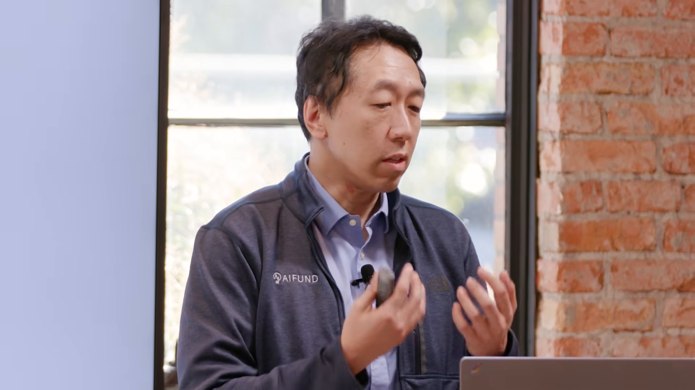
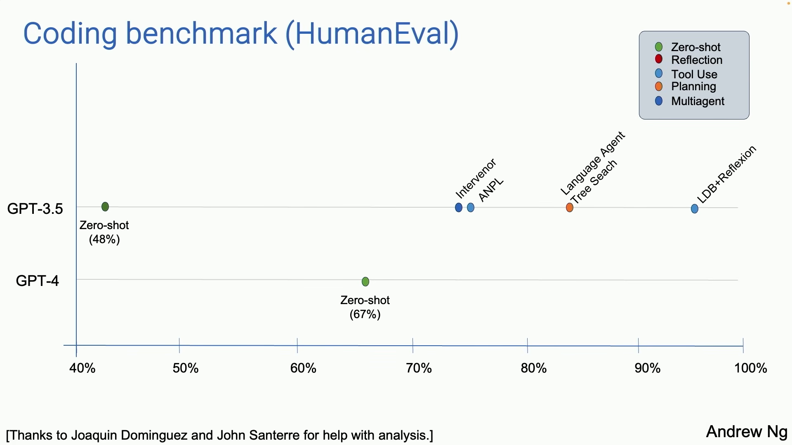
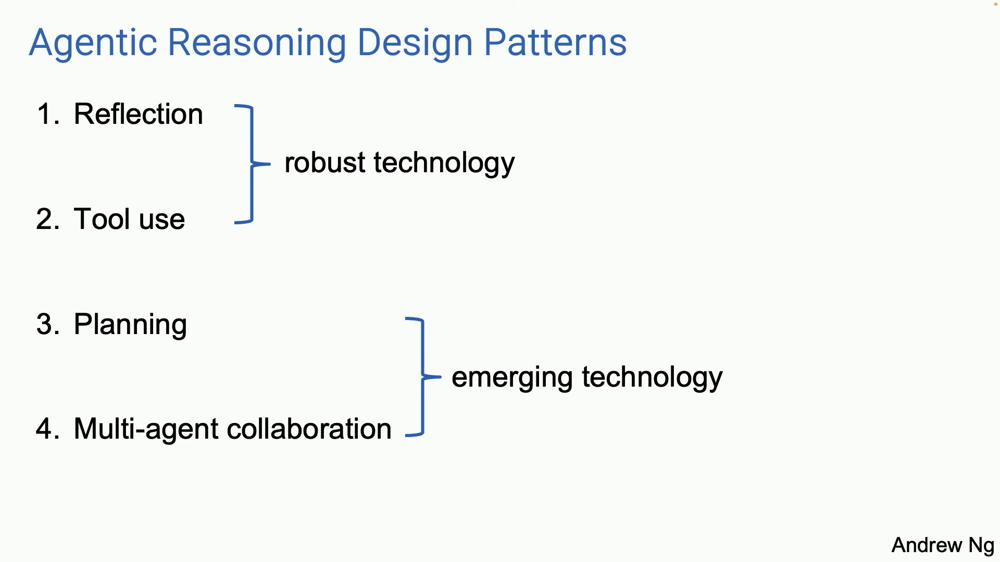
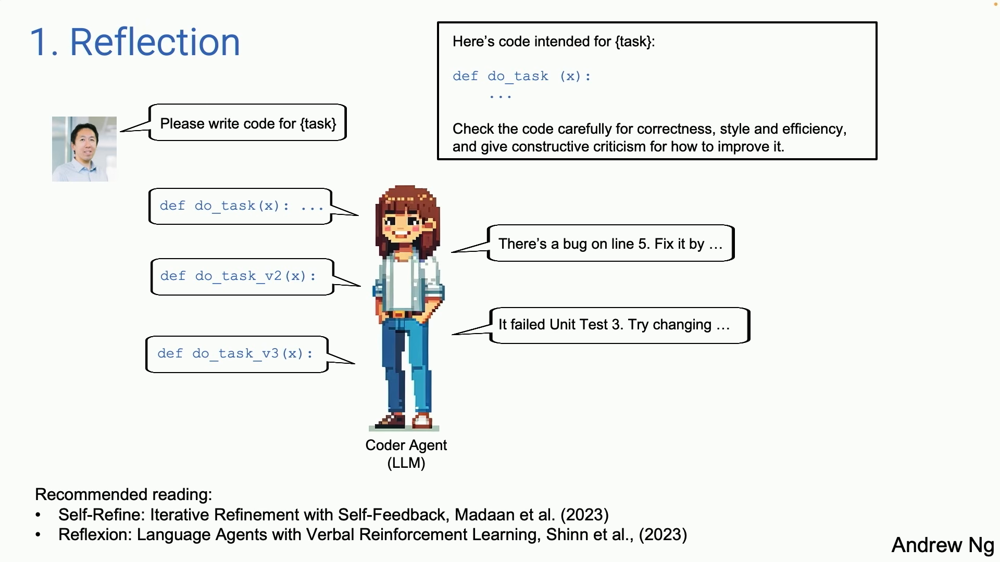
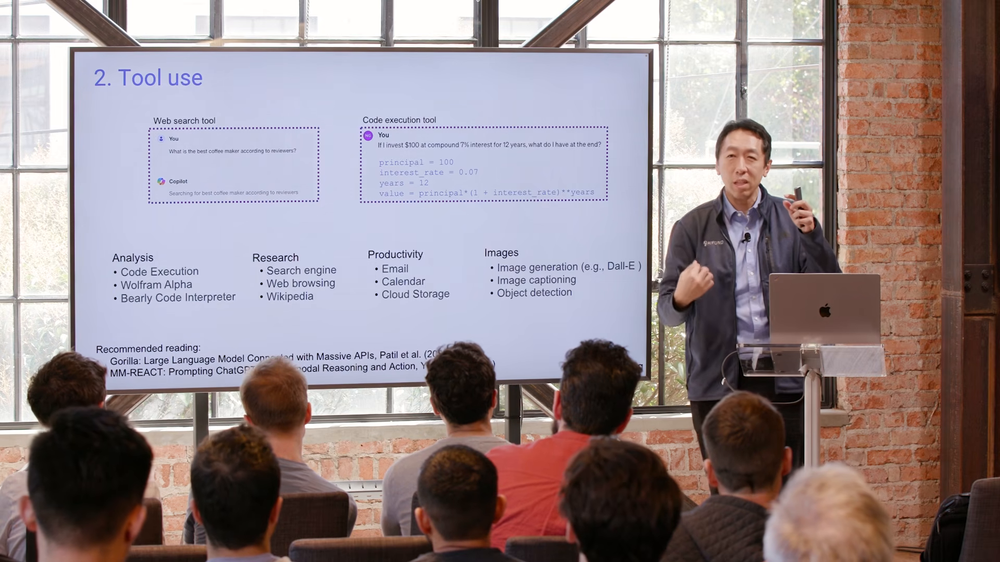
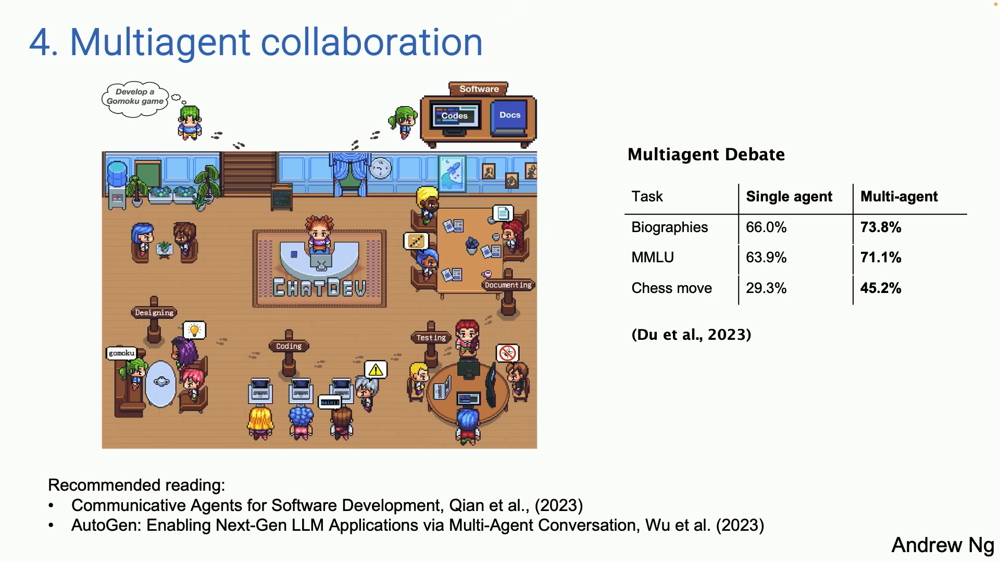

# What's Next for AI Agentic Workflows

- **Speaker**: Andrew Ng (吳恩達, AI Fund 創始合夥人、Coursera 聯合創始人、前 Google Brain 負責人、Stanford 兼任教授)
- **Conference / Channel**: Sequoia Capital AI Ascent / AI Fund Keynote
- **Video Link**: [YouTube: What's next for AI agentic workflows ft. Andrew Ng](https://youtu.be/sal78ACtGTc)
- **Duration**: 13 分 39 秒
- **Keywords / Tags**: #AIAgents #AgenticWorkflows #Reflection #ToolUse #Planning #MultiAgent #HumanEval #FastTokens
- **Interactive Presentation**: [全螢幕開啟第 2 講教學 HTML 簡報 (Reveal.js)](slides_02_andrew_ng.html?v=clean_20261124)

---

## Executive Summary (TL;DR)
AI 領域泰斗 Andrew Ng（吳恩達）在此次主題演講中指出，AI 開發範式正迎來從「Zero-shot 非代理工作流（Non-agentic）」向「迭代式代理工作流（Agentic Workflows）」的巨大跨越。實驗數據顯示，**GPT-3.5 搭配 Agentic 工作流在 HumanEval 編程評測中的表現，竟然直接超越了 Zero-shot GPT-4**，證明工作流設計能大幅釋放甚至跨越基礎模型世代的差距。吳恩達歸納了推動當前 Agentic 進展的四大核心設計模式：**Reflection（自我反思）**、**Tool Use（工具調用）**、**Planning（路徑規劃）** 與 **Multi-agent Collaboration（多代理協同）**，並預測高速 Token 生成（Fast Token Generation）將成為推動未來 AI Agent 大規模落地的關鍵基礎設施。

---

## I. 核心論點與背景動機 (Core Thesis & Motivation)

### 1. 非代理模式的瓶頸：Zero-shot 一次性生成
- **傳統 Non-agentic 互動**：
  使用者輸入一個 Prompt，大型語言模型（LLM）立即從第一個字不間斷地生成到最後一個字。這如同要求一位作家在完全不打草稿、不查閱資料、不使用 Backspace 退格鍵的情況下，一口氣在白紙上寫出一篇完美論文。
- **Agentic 互動範式**：
  引入類似人類專家的迭代循環：先思考題目 $\to$ 擬定大綱 $\to$ 上網搜尋補充材料 $\to$ 產出第一版草稿 $\to$ 重新閱讀並反思缺陷 $\to$ 進行自我編修與重構。

### 2. 震撼評測結論：工作流超越模型世代
在學術界與產業界普遍迷信「等待 GPT-5 解決一切」之際，吳恩達團隊透過量化評測證明：透過適當的 Agentic 迴圈設計，舊一代或較小的模型（如 GPT-3.5）能夠在多項複雜任務中，徹底擊敗未經工作流增強的新一代頂級模型（如 GPT-4 Zero-shot）。

---

## II. Figure & Table Deep Dive (關鍵圖表四步深度解析)

### Figure 1: Non-agentic vs. Agentic Workflow（工作流模式對比）

<strong>Figure 1. Non-agentic vs. Agentic workflow.</strong> 左側展示傳統 Zero-shot 一次性文字生成；右側展示包含寫大綱、網路檢索、撰寫草稿、主動反思與修訂的迭代式 Agent 閉環架構。

1. **視覺組件拆解**：
   - 左側（Non-agentic workflow）：單一線性區塊，顯示使用者輸入 Prompt 後，由 LLM 一次性輸出完整文章。
   - 右側（Agentic workflow）：包含多步驟有向流程圖（Directed Flowchart），依序包含：`think` $\to$ `search web` $\to$ `draft` $\to$ `read/critique` $\to$ `revise` 迴圈。
2. **資料與機制流向**：
   - 傳統模式無狀態且無反饋；Agentic 模式具備記憶暫存與反思路徑，第一輪輸出並非終點，而是作為下一輪批評檢查（Critique）的輸入，形成自我收斂的狀態機。
3. **物理意義與設計意圖**：
   - 破除對單次推理長度的迷思。軟體工程的本質是迭代與除錯，Agent 必須獲得類似人類的反思與修正空間，才能突破幻覺與邏輯漏洞。
4. **關鍵量化結論**：
   - 雖然 Agentic 工作流消耗的 Token 數量增加 3 至 5 倍，但複雜任務的最終正確率大幅提升。

---

### Figure 2: Coding Benchmark on HumanEval（編程基準評測成果）

<strong>Figure 2. Coding Benchmark (HumanEval).</strong> 各模型在 Zero-shot 與 Agentic 工作流下的代碼生成通過率對比。GPT-3.5 結合代理工作流後成功超越了 Zero-shot GPT-4。

1. **視覺組件拆解**：
   - 長條柱狀對比圖，橫軸為不同模型與工作流組合，縱軸為代碼基準測試 HumanEval 的一次通過率（Pass@1）。
   - 對比組別包含：GPT-3.5 (Zero-shot)、GPT-4 (Zero-shot)、以及加入 Agentic 迭代工作流後的 GPT-3.5 與 GPT-4。
2. **資料與機制流向**：
   - 原始 GPT-3.5 零樣本分數約 48.1%；GPT-4 零樣本達到 67.0%。
   - 當為 GPT-3.5 套上包含單元測試與自我反思的工作流時，其成績大幅躍升突破 80% 以上，直接超越原生 GPT-4！
   - 當 GPT-4 同樣套用 Agentic 工作流時，正確率逼近 90%，大幅拉開天花板。
3. **物理意義與設計意圖**：
   - 這是全場演講最具說服力的鐵證：架構設計（Workflow）的紅利，足以彌補底層模型參數規模與預訓練資料的代差。
4. **關鍵量化結論**：
   - GPT-3.5 (Agentic) 比 GPT-3.5 (Zero-shot) 提升超過 30 個百分點。
   - 確立了「先改善工作流架構、再更換大模型」的工程優先級。

---

### Figure 3: Four AI Agentic Design Patterns（四大核心設計模式）

<strong>Figure 3. Four AI Agentic Design Patterns.</strong> 吳恩達歸納出推動當前自主代理落地的四大設計模式：Reflection、Tool Use、Planning 與 Multi-agent Collaboration。

1. **視覺組件拆解**：
   - 2x2 矩陣分類看板，四個維度分別標註為：
     - **Reflection（自我反思）**
     - **Tool Use（工具調用）**
     - **Planning（動態規劃）**
     - **Multi-agent collaboration（多代理協同）**
2. **資料與機制流向**：
   - 這四大模式既可獨立使用，亦可自由組合。從最輕量級的 Reflection（單一模型提示詞自檢），到 Tool Use（擴展外部能力），進而提升為 Planning（全域路徑拆解）與 Multi-agent（專業角色協商）。
3. **物理意義與設計意圖**：
   - 為紛繁複雜的 Agent 論文與開源專案（AutoGPT、ChatDev、LangChain、CrewAI）建立清晰、嚴謹的分類學（Taxonomy），讓工程師能系統化評估各架構的適用邊界。
4. **關鍵量化結論**：
   - 目前在工業界落地成熟度最高且實施成本最低的為前兩者（Reflection 與 Tool Use）；高階複雜系統則逐步向 Planning 與 Multi-agent 演進。

---

### Figure 4: Reflection Pattern Workflow（反思模式運作機制）

<strong>Figure 4. Reflection.</strong> 反思模式之雙節點迴圈：代碼生成器輸出程式碼 $\to$ 批判者審查語法與邏輯並產出 Constructive Criticism $\to$ 生成器依據反饋重構代碼。

1. **視覺組件拆解**：
   - 包含兩大核心節點與一個回饋迴圈：
     - `Generator`：依據需求產出第一版代碼或文字。
     - `Critic / Reflector`：檢查代碼邊界、命名規範、時間複雜度或直接執行 Unit Tests。
     - 回饋弧線（Feedback Loop）：將具體錯誤回傳給 Generator 進行再生成。
2. **資料與機制流向**：
   - 透過提示詞分離（Prompt Separation）讓同一個模型切換視角，甚至引入真實的 Python 解譯器運行結果，把語法錯誤轉換為確定性反思上下文。
3. **物理意義與設計意圖**：
   - 解決神經網絡在生成時「自我合理化」的盲點。人類程式設計師很少能在第一版寫出完全無瑕疵的代碼，反思模式為模型賦予了審視自身輸出的第二思維。
4. **關鍵量化結論**：
   - 僅需增加 1 到 2 次迭代對話，即可過濾掉超過 60% 的顯淺型別與語法失誤。

---

### Figure 5: Tool Use & Planning Framework（工具調用與規劃機制）

<strong>Figure 5. Tool Use & Planning.</strong> 模型主動辨識意圖並調用外部工具（搜尋、代碼執行、專用 API），並在 Planning 架構下將長遠目標拆解為可執行的依賴路徑拓撲。

1. **視覺組件拆解**：
   - 展示 LLM 作為大腦調用周邊插件的架構圖：Web Search、Code Interpreter、Wikipedia API、以及基於 HuggingGPT 的多模型調度序列。
2. **資料與機制流向**：
   - LLM 分析使用者輸入 $\to$ 判斷內部知識庫無法滿足 $\to$ 生成具特定格式（JSON / Function Call）之工具調用指令 $\to$ 外部環境執行並返回 Raw Data $\to$ LLM 整合輸出。
3. **物理意義與設計意圖**：
   - 確立 LLM 在系統中的定位：不是包山包海的知識資料庫，而是具備推理與工具操作能力的「通用協調器（Orchestrator）」。
4. **關鍵量化結論**：
   - 工具使用大幅消除了數值計算失真與時效性資訊過期的問題，精準度提升至確定性工具的水準。

---

### Figure 6: Multi-Agent Collaboration（多代理分工協作）

<strong>Figure 6. Multi-agent collaboration.</strong> 以 ChatDev 為代表的多代理協同架構：將軟體公司職位（CEO, Product Manager, Programmer, Code Reviewer, Tester）分配給不同提示詞的 Agent 進行跨角色辯論與產出。

1. **視覺組件拆解**：
   - 流程圖展現多個 Agent 角色相互對話的網絡：需求分析（Product Manager） $\to$ 代碼編寫（Programmer） $\to$ 代碼審查（Reviewer） $\to$ 測試驗證（Tester）。
2. **資料與機制流向**：
   - 每個 Agent 擁有獨立的 System Prompt 與職責範圍，透過對話管道傳遞結構化資訊，模擬真實敏捷開發團隊的 PR 審查與討論流程。
3. **物理意義與設計意圖**：
   - 克服單一 Prompt 無法兼顧全域視野與局部細節的缺點。透過角色特化（Specialization），讓特定 Agent 專注於極致挑錯，大幅降低盲點漏檢率。
4. **關鍵量化結論**：
   - 在複雜全棧專案開發中，多代理協作顯著改善了模組間介面不一致的缺陷。

---

## III. 核心架構與四大設計模式總結 (Architecture Deep Dive)

綜合演講內容，四大 Agentic 設計模式的成熟度與實施邊界如下：

| 設計模式 (Pattern) | 核心概念 (Core Concept) | 代表性機制 / 工具 | 工業落地難度 | 關鍵效益 |
| :--- | :--- | :--- | :--- | :--- |
| **1. Reflection** | 模型對自身輸出進行二次審查與批判 | Dual-prompt、Self-Debugging、單元測試反饋 | 低（最推薦優先導入） | 以極低成本過濾 60%+ 表面邏輯錯誤 |
| **2. Tool Use** | 調用外部 API、搜尋引擎與執行環境 | Function Calling、Code Interpreter、MCP | 中（依賴 API 穩定度） | 消除數值計算幻覺，擴展外部動態知識 |
| **3. Planning** | 自動將宏觀目標拆解為多步驟執行序列 | HuggingGPT、Plan-and-Solve、Tree of Thoughts | 高（路徑易飄移失控） | 能自主探索多步驟複雜長鏈任務 |
| **4. Multi-agent** | 多角色分工、相互審查與辯論共識 | ChatDev、CrewAI、AutoGen、Swarm | 高（Token 消耗大、協商成本高） | 模擬組織分工，有效降低複合型盲點 |

---

## IV. 未來趨勢與思維範式轉變 (What's Next & Implications)

吳恩達在演講尾聲對未來 AI 技術演進提出了兩個至關重要的觀點：

1. **高速 Token 生成是 Agent 的生命線 (Fast Token Generation)**：
   - 在傳統對話中，生成速度只需滿足人類閱讀上限（約 5–10 tokens/s）即可。
   - 但在 Agentic 工作流中，模型產生的絕大部分 Token 是用來**給下一個 Agent、批判者或 Linter 閱讀**的。
   - 因此，業界亟需極速推論晶片與演算法（每秒數百至數千 Tokens），即使單一 Token 的推理質量稍遜，也能藉由工作流的多次迭代反思達成更高的整體品質。
2. **學會耐心等待 Agent 交付 (Patiently Waiting for Results)**：
   - 使用者心智模型必須改變：以往要求 AI 在點擊 Enter 後 1 秒內給出答案；而在 Agent 時代，我們必須習慣給予 Agent 幾分鐘甚至幾小時進行規劃、寫測試、自我反思與重構，以換取高可靠度的嚴謹成果。

---

## V. 概念互聯 (Cross-Referenced Concepts)

- [[agentic-design-patterns|AI Agentic 四大設計模式 (Reflection, Tools, Planning, Multi-Agent)]]
- [[deterministic-guardrails|確定性防護欄與編譯約束 (Deterministic Guardrails)]]
- [[ai-agents-code-generation|AI Agents 規模化代碼生成體系 (Scaling AI Coding Agents)]]
- [[fast-token-generation|高速 Token 生成對代理架構的關鍵影響 (Fast Token Generation)]]
